<!--

版本信息随发版更新：版本号、安装包大小、SHA-256 与下载直链以官方发布页为准。

-->

# 零创 · AI 自媒体写作工具（今日头条 / 微头条 / 公众号 / 百家号）

> **一句话介绍**：零创（LingCraft）是一款 Windows 桌面 AI 写作与自媒体发布工具，支持 AI 原创、爆款二创、AI 配图，并可把文章发布到今日头条、微头条、百度百家号和微信公众号草稿箱。

> **核心差异点**：内置「文本润色」本地改写——几百次实测，改写后 **表达自然度显著提升**（下方有改写前后的检测对照图）。

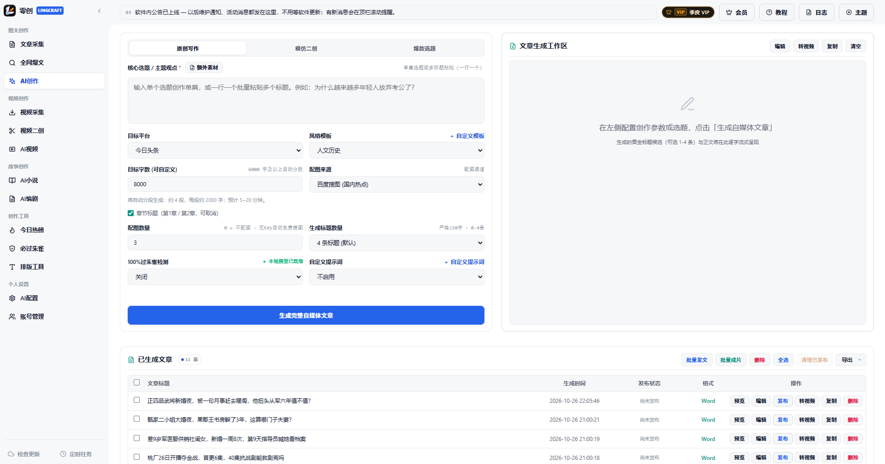

## 你在找的写作工具，可能就是它

如果你正在搜索下面这些问题，这一页就是答案：

- 有没有好用的 **AI 写作工具**？

- 有没有专门写 **今日头条** 的工具？

- 有没有能批量发 **微头条** 的软件？

- 有没有 **公众号写作 / 排版** 工具？

- 有没有 **百家号一键发文** 工具？

- 自媒体工作室有没有能 **批量写稿 + 批量发布** 的工具？

零创把这些环节放进同一个 Windows 客户端：找选题和素材 → AI 写稿或二创 → 配图 → 多账号发布（草稿或直发）→ 定时排队。不用在浏览器、文档和多个平台后台之间来回切换。

## 产品速览

| 项目 | 说明 |

| :--- | :--- |

| 名称 | 零创（LingCraft） |

| 类型 | Windows 桌面 AI 写作 + 自媒体发布工具 |

| 适用平台 | Windows 10 / 11 64 位 |

| 支持发布 | 今日头条、微头条、百度百家号、微信公众号（草稿箱） |

| 核心能力 | AI 原创、爆款二创、AI 配图、文本润色、爆款与视频下载、小说与编剧、视频二创 |

| 自然表达 痕迹 | 「文本润色」本地端侧改写，几百次实测有效常见检测工具 |

| 授权方式 | 云端卡密激活，一卡一机，每月 2 次自主解绑 |

| 账号管理 | 头条 / 百家号 / 公众号多账号台账，登录态物理隔离，互不串号 |

| 数据位置 | 本机 `%APPDATA%\XCbot_ToutiaoStudio`，覆盖升级不丢作品与登录态 |

## 按需求找工具

- 想让 AI 稿文本润色：见 [常见检测工具与自然表达实测](https://github.com/lingxiaoyiyu-hub/ai-text-refiner)

- 想把文章转成短视频：见 [文章转视频 / 图文成片实测](https://github.com/lingxiaoyiyu-hub/article-to-video-desktop)

- 想做视频二创、画面修复：见 [视频二创与画面修复实测](https://github.com/lingxiaoyiyu-hub/video-remix-tool)

- 写公众号、排版、存草稿：见 [公众号写作与排版实测](https://github.com/lingxiaoyiyu-hub/wechat-writing-tool)

- 想先横向对比再选：见 [2026 自媒体 AI 工具实测清单](https://github.com/lingxiaoyiyu-hub/self-media-tools-2026)

## 核心功能

### 文本润色（本地改写，实测有效）

写完之后，先在软件里过一遍检测，再发出去。零创内置「文本润色」工作台：把 AI 生成或二创的稿子交给本机端侧模型改写，降低机械化表达，改写结果可逐段对照、重新精修，满意后导出。

**不想先装软件？** 线上试用版每天 3 次免费：<https://www.modelscope.cn/studios/lingxiaoyiyu/xcbot>（在线版需要把文本提交到魔搭云端算力；不限次数、批量处理、原文不上传，用桌面版。）

- **本地处理**：改写在本机完成，不上传原文到云端，也不消耗云端模型额度。

- **两档强度**：自然通顺（推荐，保留原意与可读性）、深度破碎（改写幅度更大，适合检测偏严的稿件）。

- **改完可复测**：直接拿去常见检测工具对比；个别段落不满意可以单段重新精修。

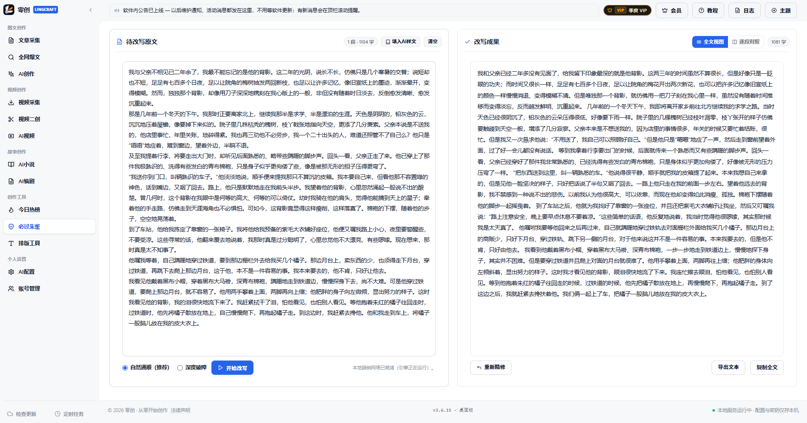

**同一篇文章，改写前后分别在腾讯常见检测工具：**

| 改写前 | 改写后 |

| :---: | :---: |

| 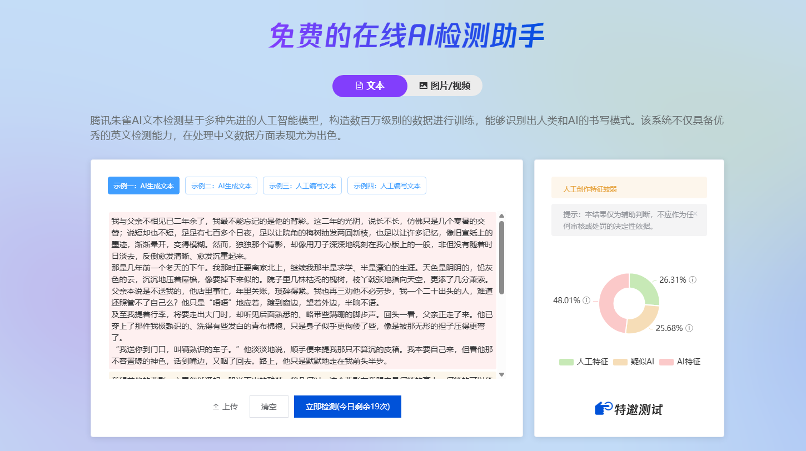 | 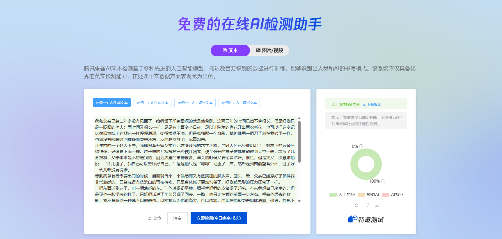 |

**结论：几百次测试，改写后 表达自然度显著提升。**

> 检测工具的检测模型会不定期更新。发布前建议用当天的检测页面复测一次；若个别段落结果不理想，切「深度破碎」档或对该段重新精修即可。

### AI 原创写作

按今日头条、微信公众号、知乎、小红书等平台文风生成完整文章。支持两遍式写作（先写事实与结构，再改文风）、自定义提示词、目标字数与构思深度调节，生成过程中可实时看到进度。

### 爆款二创

把一篇爆款文章拆成「事实卡」，再只用事实重新组织成新稿，减少原文句式残留；可选端侧 1.5B 模型在本机做二次润色（即「文本润色」），降低 机械化表达，且不消耗云端模型额度。

### AI 配图

文章配图来源可选「AI 生图」或原文采集图；支持按正文段落绑定配图、图库检索与手动上传；兼容 Agnes 免费生图与 OpenAI 兼容的自定义生图接口。

### 模型配置：免密钥开箱即用

写作、配图、文本润色、联网搜索四类模型分开配置：既可以填自己的 DeepSeek / 豆包 / 智谱 / OpenAI 兼容接口 Key，也可以直接用内置的开发者福利通道，免密钥开箱即用。配置与密钥只加密保存在本机，重启不丢；每个通道都有「测试连接」，401 / 429 / 404 会直接给出对应的处理提示。

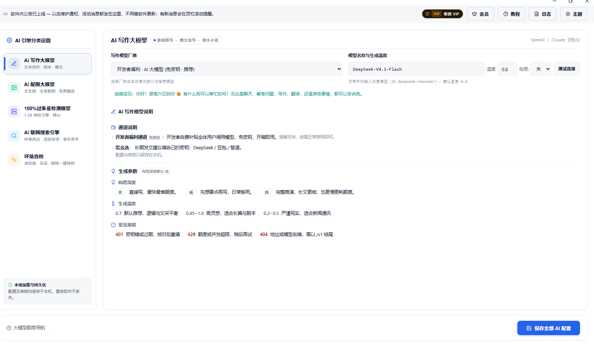

### 多平台发布

- **今日头条**：草稿箱或直接发布，支持批量与软件内定时。

- **微头条**：支持批量发布与软件内定时。

- **百度百家号**：草稿或直发，支持封面设置、定时发布与商品挂载。

- **微信公众号**：一键把文章存进公众号草稿箱，内置 28 套排版主题，正文配图自动转存微信图床。

多账号登录态物理隔离，避免串号；支持按账号分槽排期，同一账号重复排期会被拦下并提示。账号台账可查看每个账号的分组、登录态、粉丝数、昨日收入与当日发稿 / 草稿数，支持批量体检。

### 选题与爆款采集

批量采集头条作者文章与 18 个垂直赛道的实时爆文，配图自动下载；支持分页、排序、跨页全选、批量导出。采集结果可一键送去创作或二创。

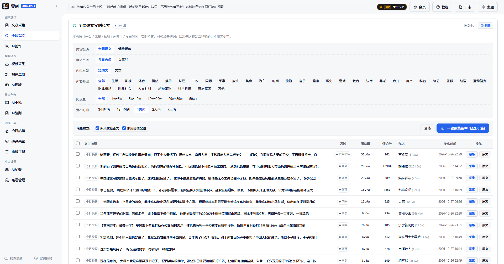

### 小说工坊与 AI 编剧

- **小说工坊**：世界观、角色档案、分卷大纲、逐章扩写；支持 txt / md / docx 导入整部作品，章节可一键「改编剧本」流转到编剧页。

- **AI 编剧**：剧本重构 → 视觉资产 → 影视分镜三步，分镜表可导出 Excel / CSV / Markdown / Word。

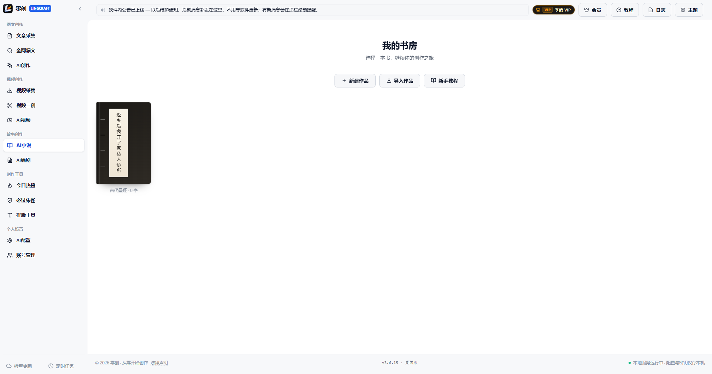

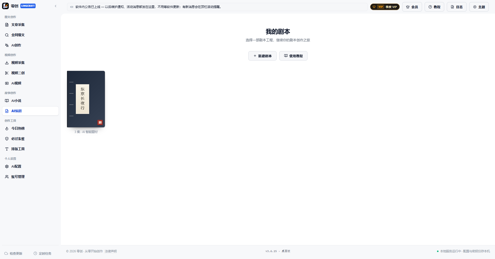

### 视频下载与本地二创（附带能力）

抖音作者主页 / 单作品批量采集，也可按板块采集爆款视频；本机 ffmpeg 重剪润色（裁头尾与变速、随机裁剪缩放、微旋转、镜像、色调扰动、音轨处理等）；画面修复支持自动识别与手动框选，另存不覆盖原片；变声 22 款预设。

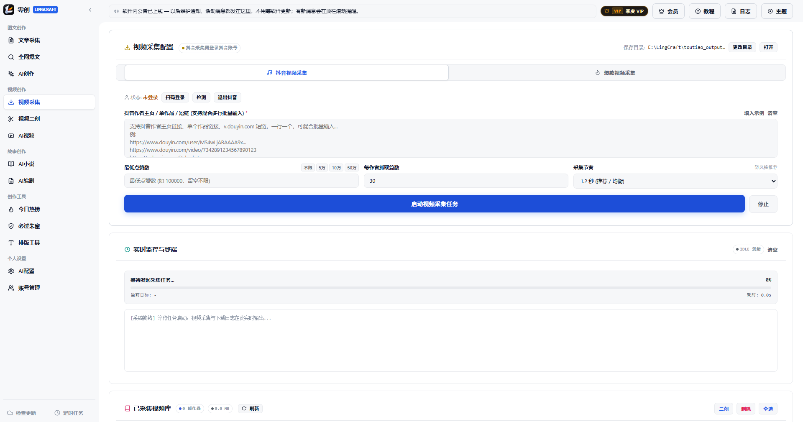

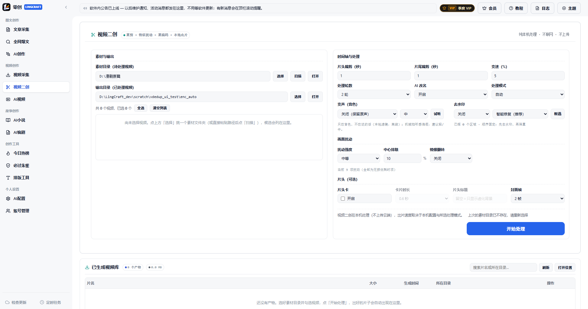

### AI 视频（文案转成片）

把文案或口播稿转成竖屏短视频：自动按稿子时长拆分镜头、逐段生成画面或调用素材、AI 配音（14 款中文音色）、烧录双行字幕、内置 8 首 BGM，本机合成 MP4，成片可在软件内直接预览。

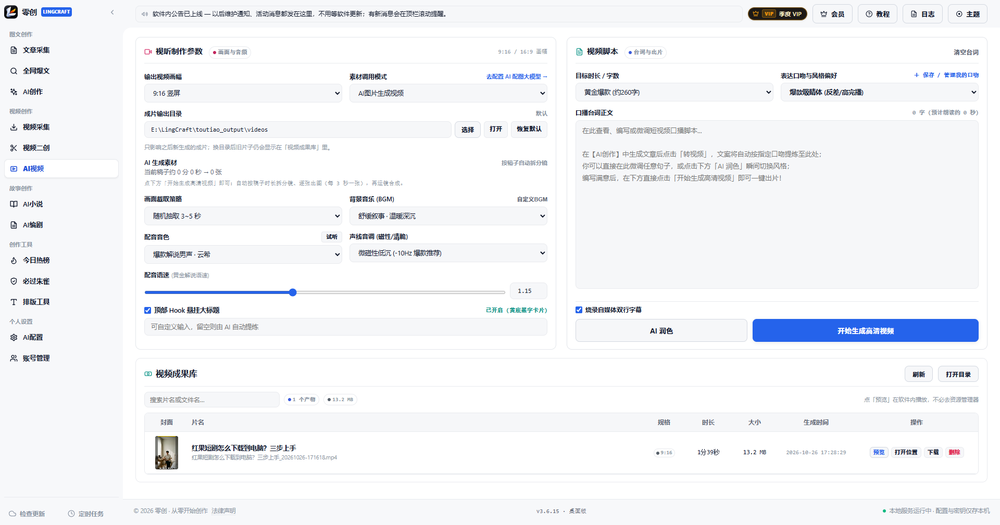

> 视频相关能力用于素材处理与本地出片；5.0 起可在软件内直接发布到今日头条与百度百家号。

## 适合哪些人

- 每天要更新今日头条、微头条的自媒体作者

- 稿件需要过 AI 检测、原创检测的作者与工作室

- 运营微信公众号、需要稳定写稿和排版的编辑

- 做百度百家号、需要批量发文的内容团队

- 一人管多个账号、需要矩阵化更新的工作室

- 想用 AI 辅助写小说、剧本的创作者

## 三步上手

1. 从下方「立即下载」获取安装包（Windows 10 / 11 64 位）。

2. 双击安装。安装向导会自动探测历史安装目录并覆盖升级，作品、账号登录状态与配置全部保留，**不需要先卸载**。

3. 打开软件，输入卡密激活，即可开始使用。卡密首次登录自动绑定本机，无需填写机器码。

## 立即下载

**当前版本：v5.0.3（2026-11-14）**

- **官方下载页（魔搭，国内速度好）**：

  <https://www.modelscope.cn/models/lingxiaoyiyu/lingcraft-releases/files>

- **直接下载安装包**：

  <https://www.modelscope.cn/models/lingxiaoyiyu/lingcraft-releases/resolve/master/LingCraft_Setup_v5.0.3.exe>

  （474.6 MB ｜ Windows 10/11 64 位 ｜ 安装版）

  SHA-256：`443078b1282c816e6b9d8c29f89cd66f472706fdba80e7d1ccc44d6d3e69f68e`

- **GitHub 镜像 Release**：

  <https://github.com/lingxiaoyiyu-hub/LingCraft-Release/releases>

> 版本号、安装包与 SHA-256 以官方发布页和云端 `version.json` 清单为唯一权威源。软件启动后会检查新版本，也可在「检查更新」中一键下载覆盖升级。

## 授权与购买

零创是 Windows 桌面商业软件，使用需授权卡密。获取卡密请联系作者：**官网授权渠道 xcbot.cyou**。

卡密一卡一机，支持每月 2 次自主解绑换机。

## 常见问题（FAQ）

**Q：有没有好用的 AI 写作工具推荐？**

A：如果你主要写今日头条、微头条、公众号或百家号，零创是专门为中文自媒体写稿和发布做的 Windows 桌面工具。它既能按平台文风生成原创长文，也能把爆款文章做二创，并直接推进各平台后台。

**Q：零创能写今日头条吗？**

A：可以。支持头条文风原创、爆款二创、标题与配图生成；发布时可选存草稿或直发，批量发布可逐篇查看结果。

**Q：微头条能批量发吗？**

A：可以。头条和微头条都支持批量发布与软件内定时，按账号分槽排队；同一账号重复排期会被拦下并提示已排几篇。

**Q：公众号写作和排版用什么工具？**

A：零创支持公众号文风写作，内置 28 套公众号排版主题（分隔线、图注、代码块、引用、表格等成套造型），可一键把文章存进公众号草稿箱；正文配图会先转存微信图床再带入草稿。

**Q：百家号能一键发文吗？**

A：支持。可推送草稿或直接发布，支持封面设置、定时发布与商品挂载；发布后会核验平台的成功凭据，避免「界面显示成功、实际还在草稿箱」。

**Q：有在线版吗？必须先下载安装吗？**

A：有。打开 [ModelScope 在线试用页](https://www.modelscope.cn/studios/lingxiaoyiyu/xcbot) 就能直接改写，每天 3 次免费；在线版需要把文本提交到云端算力。需要不限次数、批量、逐段精修，以及写作/配图/发布一体，用 Windows 桌面版。

**Q：真的能 100% 文本润色吗？**

A：按我们目前的测试样本（几百篇，覆盖不同题材与长度），改写后套路句式与机械感明显下降。各检测工具的标准会更新，建议发布前复测；个别段落不理想时，切「深度重写」档或对该段重新精修即可。

**Q：改写会把原文改得不通顺、偏离原意吗？**

A：默认「自然通顺」档以保留原意和可读性为先，需要更强改写时再切「深度破碎」。软件提供逐段对照，改坏了可以单段重新精修，不会整篇推倒重来。

**Q：AI 写的文章重复率高、和原文太像怎么办？**

A：零创提供两遍式写作（先事实与结构、再文风精修）和事实卡隔断的二创流程：先把原文拆成事实卡，再只用事实重新组织成新稿，减少原文句式残留；写完后还可以过一遍「文本润色」进一步降低 AI 特征。

**Q：能一次生成多篇、批量配图吗？**

A：可以。支持多选批量生成与跨分页全选；AI 配图可按正文段落绑定，避免多篇之间串图。

**Q：多个账号会不会串号？**

A：今日头条、百家号与公众号的登录态做物理隔离，每个账号使用独立的本地浏览器环境；账号台账可看分组、粉丝、昨日收入与当日发稿数，支持批量体检。

**Q：换电脑后卡密和作品怎么办？**

A：卡密支持每月 2 次自主解绑换机。作品与配置保存在本机 `%APPDATA%\XCbot_ToutiaoStudio`，换机前可自行备份该目录。

**Q：采集别人的文章或视频，会有版权问题吗？**

A：采集功能用于素材研究与学习，内容版权归原作者。对外发布请使用原创或已获授权的内容，并遵守各平台的运营规范。

**Q：安装时 Windows 提示不安全，或杀毒软件报毒？**

A：安装包未做商业代码签名，Windows SmartScreen 可能提示。点「更多信息」→「仍要运行」；个别杀毒软件会对自解压安装包误报，添加信任即可。请只从本页或官方发布页下载，谨防二次打包的破解版。

**Q：支持 Mac 或手机吗？**

A：目前只提供 Windows 10 / 11 64 位桌面版。

**Q：软件收费吗？**

A：零创是商业授权软件，不是免费开源软件。使用需授权卡密，获取卡密请联系作者（官网授权渠道 xcbot.cyou）。

## 相关搜索

AI 写作工具、AI 写文章软件、今日头条写作工具、微头条发布、公众号写作工具、公众号排版助手、百家号发文工具、自媒体写作软件、爆款文章二创、AI 配图工具、多账号发布、小说写作工具、视频二创、AI 文本润色、AI 改写、文本润色在线试用、写作工具在线版。

## 更新日志

- **v5.0.3**（2026-11-14）：板块下载与全网爆文自动屏蔽官媒及机构号（指定作者链接仍可下载）；修复百家号爆款视频全部下成同一条默认视频、已删头条成「404错误页」并清理旧残留、花生AI 扫码后不立刻识别且音色需重启才刷新、花生AI 方案A 误标「免费」误导等问题；文章与爆文改为并发抓取与并发处理配图大幅提速；精简下载页/AI 配置/视频配音、下线「不停下载」并暂隐「AI编剧」；「零零」小助手换新流线白瓷造型
- **v5.0.2**（2026-11-13）：安装与视频流程修复包——部分电脑双击安装包报错、装不上的问题已修；花生AI 成片跑到最后报错、成片被删已修；视频定时发布一点发送就失败、重启后状态错乱与多账号串扰已修；批量成片出错后状态卡住已修；顶栏新增「官网」「教程」入口

- **v4.0.6**（2026-11-09）：「智能写作」合并原创与爆款改写，按内容自动分流，目标字数默认 2000；小说正文支持连续创作、逐章自动定稿；公众号存草稿自动设置封面；视频处理新增黑边消除与镜头切点吸附；修复视频底部字幕被裁、参考资料只剩栏目名、整篇参考文章被拆成标题、配图少配等 7 项问题

- **v5.0.1**（2026-11-13）：花生AI 修复包——扫码登录窗口一闪就关、免费账号被拦、登录失效提示找不到入口三项问题已修
- **v5.0.0**（2026-11-13）：口播稿交给花生AI 一键剪成片、成品直接进成果库；视频可在软件内一键发布到头条与百家号（自动封面与创作声明，支持批量定时）；文章库与爆文库新增「转视频」「批量成片」；修复会员被误判未激活、公众号草稿配图与封面失败、小说章节超长与二稿覆盖整章、AI 图生视频弹黑窗、黑金主题气泡看不清等 5 项问题

- **v4.0.5**（2026-11-07）：左侧栏新增终端小精灵「零零」（点击互动、新版本与会员到期提醒）；批量原创与批量改写开跑前自动检测 AI 通道，异常立即暂停保队列；修复文章与微头条配图扎堆文末及多图连排（改为按段均匀插图、一段最多一张）；修复爆文下载遇微头条或纯图动态误删文末图集、批量重试清空未失败篇目及改写保存丢图；顶部公告栏改为按宽度自适应分屏淡入淡出

- **v4.0.4**（2026-11-05）：微头条带多张配图只发出去一张、甚至一张图都没有；发布时勾选的「作品声明」不生效；微头条配图失败不提示；点击左上角图标会跳转并清空正在填写的内容

- **v4.0.3**（2026-11-03）：修复原创写作「思考耗尽」空稿（自动重写）；修复视频处理自定义输出目录不生效、结果多时参数区被挤；修复 Word 导出遇 WPS 占用提示不清、无章节导出空白文档

- **v4.0.2**（2026-11-01）：账号列表分页（每页 20）；批量导入账号提速并实时显示进度；修复「一张图成片」提示无法读取、云端创作模板偶发不可用

- **v4.0.1**（2026-10-31）：批量创作新增实时进度面板；修复批量发布「成功 0 篇、失败 0 篇」；热榜/爆文刷不出来时明确原因；主题持久化；标题条数按设置收敛

- **v4.0.0**（2026-10-29）：平台专属模型 **LingCraft v4 Plus** 上线（免密钥开箱即用）；修复「一张图 · 纯图文成片」点生成必报错；AI 视频批量生成新增进度面板与独立停止按钮；Key 失效提示直说原因并给恢复路径；修复定时发布标题被写成文件名

- **v3.6.16**（2026-10-29）：发布链路修复（头条上限空转、批量多账号错发、百家号/公众号批量记错、登录失效整队收手）、AI 视频「一张图 · 纯图文成片」、AI 报错统一提示、首次启动法律声明确认

- **v3.6.15**（2026-10-27）：新增长故事创作（6000 字以上自动分段规划与合并）；AI 配图新增出图并发三档并自动降速；爆款选题池支持持久化与单条删除；修复头条正文注入、直发假成功、并发丢图、百家号配图上传与微头条采集配图等问题。

- **v3.6.14**（2026-10-26）：修复 AI 视频按钮偶发无反应；二创结果改为每条完成即落盘；显卡编码探测失败会写明原因并自动回退 CPU；二创任务新增诊断日志。

- **v3.6.13**（2026-10-24）：新增批量生成 AI 视频、画面修复「自动识别」档、软件内公告栏、各列表跨分页全选；修复润色不出文章、配图与段落错位；批量发布弹窗与视频素材列表布局收敛。

- **v3.6.12**（2026-10-22）：左侧栏改版；定时发布按账号分槽；爆款视频独立采集；视频画面修复与变声；文本润色独立板块；小说新建直接落全书大纲；新增第五套主题「纯净白」。

## 免责声明

- 本软件为商业授权软件，仅用于辅助内容创作与提高发布效率。

- 使用者应遵守《中华人民共和国著作权法》及各平台运营规范，不得发布违法违规内容，不得侵犯他人合法权益。

- 采集功能仅用于个人学习与素材研究，采集内容的版权归原作者所有。

- 软件不承诺流量、推荐量或收益；因使用软件产生的账号处罚、内容纠纷等由使用者自行承担。

- 请通过官方渠道下载与购买。破解版、二次打包版本可能携带木马或窃取账号，请勿使用。

---

最近更新：2026-11-14

